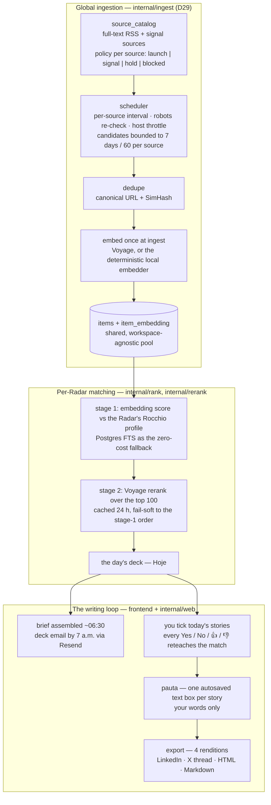

# Architecture

How Kloxus is built, and why — the map for reading this repository cold.
Product framing lives in the [README](../README.md); every dated call
below links into the running log in [decisions.md](decisions.md).

## The shipped loop

Two loops share one Postgres database: a **global ingestion loop** that
polls sources once for every workspace, and a **per-Radar matching
loop** that turns the shared pool into each person's morning brief.

- **Ingestion is global**: one scheduler polls the shared catalog for
  every workspace — N users still mean one request per source per
  interval, and new items are deduplicated, classified and embedded once
  for everyone (D29).
- **Matching is per-Radar**: the beat (plus its editorias) is the query;
  story-level *Yes* / *No* / thumbs feedback is the supervision signal
  that keeps retraining the match.
- **The email is the delivery**: a claimed Radar gets the assembled deck
  in its inbox every morning; the same deck waits in the app.
- **Generative AI is optional**: `KLOXUS_LLM_MODE` picks the posture —
  `auto` allows real calls inside hard caps, `off` runs the whole loop
  deterministically at $0 (D35). Under the owner freeze on paid AI
  (D37/D40) the deployed app takes the deterministic path.

The earlier newsletter-issue pipeline (`internal/pipeline`: collect →
dedupe → triage → storylist → dossier → deepdive → draft → citecheck,
then human approval and reader send) stays in the tree **parked** under
the same freeze — it is not part of the shipped loop and is not wired
into the product flow.

## Stack, and why

|| Piece | Choice | Why |
|| --- | --- | --- |
|| Backend | Go (`net/http`), one binary | SPA, prompts, migrations and demo data are `go:embed`-ed into a single artifact — no Node server or CDN in production, tests run fully offline (D22). |
|| Front end | React 19 + TypeScript + Vite → `internal/web/appdist` | One JSON contract (`/api/v1`, see [api.md](api.md)): the server parses and owns the issue document, the client only displays state and invokes mutations (D21, D22). |
|| Database | Postgres on Supabase Free via `pgx`, embedded migrations, optional pgvector | A shared schema with `workspace_id` on tenant tables replaced one SQLite file per visitor; used as plain Postgres only (no Supabase auth/RLS/functions) so a single SQL dialect suffices (D28). `item_embedding` stores a real `vector(256)` when pgvector exists and an identical TEXT literal otherwise (D57). |
|| Hosting | Fly.io — `kloxus` app (`fly.toml`, gru) + `kloxus-demo` (`fly.demo.toml`) | The feed scheduler runs inside the web process, so one machine stays up (a fully stopped app would stop ingesting). The fixture demo is the fallback URL and is never touched by deploys (D36). |
|| Model calls | Anthropic behind `llm.Provider` (`internal/llm`) | `Anthropic`, `Replay` (recorded fixtures), `Recorder` and `None` share one interface, so the test bed and demo cost nothing and real calls are a config choice. Every call passes prompt-size caps, a per-run USD cap, a global daily cap and a kill switch (D32, D40). |
|| Embeddings + rerank | Voyage AI (`voyage-4-lite`, `rerank-2.5-lite`) plus a deterministic local embedder | `internal/voyage` is a thin HTTP client with per-group rate limits, hard daily USD caps and a cost ledger (D60). `internal/embedding` is a free feature-hashing embedder (256-dim) + lexicon classifier that needs no model call and works with or without pgvector (D57). Stage-2 rerank runs once per run over the stage-1 top 100, cached 24 h, fail-soft to the stage-1 order (D63). |
|| Email | Resend (`internal/delivery`) | Sending-only key restricted to the sender domain; confirmed addresses only; global and per-workspace daily caps sized under the free tier (D33). Carries the magic-link claim and the morning deck email. |
|| Payments | AbacatePay PIX (`internal/payments`) | Parked — the reader-checkout demo is not part of the shipped loop (D34, D58). |
|| Fetch + search | Firecrawl (`internal/sources`) | Sponsor credits; monitors/scrapes sources without RSS and backs topic discovery, always inside the source policy (D14, D30). |

## Standing rules

- **The AI never writes the person's text.** The only editable region of
  a pauta is the author's own writing; AI output is atom content in the
  document schema, not user-editable prose.
- **Every story keeps its source.** Each card and each exported line
  links back to the outlet that published it.
- **Nothing leaves without an explicit action.** Kloxus assembles and
  suggests; the person picks the stories, writes, and exports — the app
  publishes nothing on its own.
- **Publisher rules are respected.** Per-source catalog policies,
  robots.txt re-checked daily, no mirrors or endpoint workarounds, and a
  custom-URL SSRF guard (D29).
- **Zero paid AI is the current posture.** The owner froze paid model
  use after ~USD 7.86 of spend (D37, hardened into code caps by D40):
  real ingestion and the deterministic/manual-compose loop carry the
  MVP, and AI grouping/analysis/generative drafting are parked behind
  the deployed kill switch — not deleted.

## Decisions D27–D36

The pivot to the hosted real app, compressed — full text and rationale
in [decisions.md](decisions.md):

|| # | Decision (gist) | Status |
|| --- | --- | --- |
|| D27 | Submission target is a hosted real app — real sources, model calls, email, Postgres. React becomes the only UI; fake providers stay as test bed and runtime fallback; the fixture demo stays deployed as the fallback URL. | Active; scoped by the D37 freeze and the KLOX-122 publishing flag |
|| D28 | Storage moves to Postgres on Supabase Free, plain Postgres only, one shared schema keyed by `workspace_id`. | Active — supersedes D1/D10 |
|| D29 | Ingestion splits from editorial work: feeds are fetched once, globally, from a seeded `source_catalog` with a policy per source; robots re-checked daily; anonymous workspaces pick catalog-only. | Active |
|| D30 | Topic discovery = query expansion + keyword search over the catalog (Firecrawl Search; Daily Journal API per D31). | Partially dormant — the DJ half is off (see D31) |
|| D31 | Daily Journal joins as a `signal` source via its public API only, with a hard daily request cap. | Reversed — D41 removed it, D57 restored it, D61 removed it again; the client stays in the tree dormant, opt-in off |
|| D32 | Real LLM calls are guarded: per-workspace budget, global daily cap, kill switch, retries, panic recovery; a second provider fits the same `Provider` interface. | Active; caps hardened by D40 |
|| D33 | Email via Resend with a sending-only restricted key, confirmed addresses only, daily caps; a magic-link claim is the auth model. | Active |
|| D34 | Reader checkout demonstrates the paywall with a single Kloxus test-mode AbacatePay key. | Amended by D58 — one-time PIX granting 30 days; parked, not in the shipped loop |
|| D35 | `KLOXUS_LLM_MODE=off` runs a documented deterministic pipeline at $0. | Active — the posture the app runs under the D37 freeze |
|| D36 | Every PR to `main` deploys the shared `kloxus` Fly app and is verified by a fixed routine, serialized through release windows (KLOX-26 ledger); `kloxus-demo` is never touched. | Active |

## Reading the code

- `internal/ingest` — global scheduler, feed fetching, robots, the
  dormant Daily Journal API client.
- `internal/rank`, `internal/rerank`, `internal/embed`,
  `internal/embedding`, `internal/voyage`, `internal/dedupe` — free
  dedupe and the two-stage matching engine.
- `internal/pipeline` — the parked generative issue pipeline
  (`stage_collect` … `stage_citecheck`); `stage1.go` + `rank.go` are the
  deterministic ranking path it shares with the deck.
- `internal/store` — Postgres repositories, workspace-scoped, embedded
  migrations under `migrations/`.
- `internal/web` — the `/api/v1` server: onboarding, match, today's
  deck, the pauta editor, export renditions, the deck mailer.
- `internal/llm`, `internal/editorial`, `internal/delivery`,
  `internal/payments` — providers, the (parked) editorial guide, mail
  and PIX.
- `frontend/` — the React SPA built into `internal/web/appdist`.
