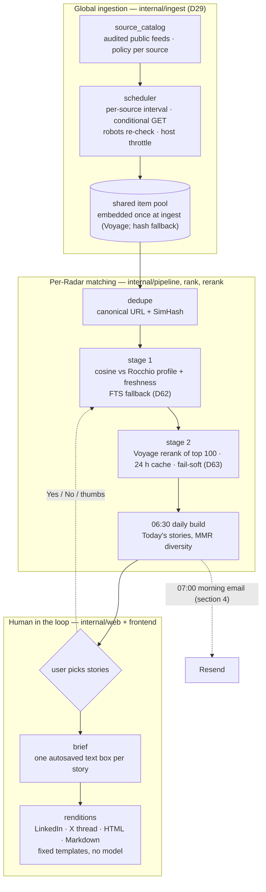

# Architecture

How Kloxus is built, and why — the map for reading this repository cold.
Product framing lives in the [README](../README.md); every dated call
below links into the running log in [decisions.md](decisions.md).

## The shipped loop

Two loops share one Postgres database: a **global ingestion loop** that
polls sources once for every workspace, and a **per-Radar matching
loop** that turns the shared pool into each person's morning brief.

- **Ingestion is global**: one scheduler polls the audited source
  catalog once for every workspace — N users still mean one request per
  source per interval — and each new item is embedded once into the
  shared pool: Voyage when its key and daily cap allow, the free
  deterministic hashing embedder otherwise (D29, D57, D60).
- **Dedupe and matching are per-Radar**: items cluster into stories
  (canonical URL + SimHash near-duplicates) when the Radar's deck is
  built — dedupe runs per Radar, not at ingest — and stage 1 scores
  each story by embedding cosine against the Radar's Rocchio profile
  plus freshness, with Postgres FTS standing in whenever vectors are
  missing (D62). Stage 2 asks Voyage to rerank the stage-1 top 100 once
  per ranking run, cached 24 h, silent on failure (D63). The Radar's
  topic and the person's *Yes* / *No* / thumbs answers are the
  supervision signal that keeps retraining the match.
- **The deck rebuilds every morning**: at 06:30 America/Sao_Paulo a
  sweep re-ranks every Radar visited in the last 7 days — stage-1
  scoring plus an MMR pass so the day's cards do not repeat one event —
  and stores the snapshot, so *Today's stories* opens ready. Any
  ranking-changing answer drops the snapshot and the next view rebuilds
  it live.
- **Paid calls fail soft**: a missing key, a spent daily USD cap, or a
  failed call never blocks the deck — embeddings fall back to Postgres
  FTS, and the reranker keeps the stage-1 order (D60, D62, D63).
- **The morning email closes the loop**: at 07:00 a Radar with a saved
  account gets one "your stories are ready" mail — the day's top titles
  and a 72 h magic link — gated by `KLOXUS_DAILY_PAUTA_MAIL`, skipped
  when the day has no new stories, one send per owner per day. Every
  send carries a one-click unsubscribe (`/daily-mail/unsub` plus
  `List-Unsubscribe` / `List-Unsubscribe-Post` headers) that works with
  the publishing surface off.
- **Generative AI (Claude) is enabled in production under hard caps and
  a live kill switch; matching uses Voyage embeddings and reranking,
  and the AI never writes the commentary.** `KLOXUS_LLM_MODE` picks the
  posture — `auto` allows real calls inside the caps, `off` runs the
  whole loop deterministically at $0 (D35, D59).
- **Export stays editable**: the brief remains writable after export; a
  rendition whose source text moved on is flagged "the brief changed
  since this version was made" and refreshes only when the person asks
  — nothing is locked (D68).

The earlier newsletter-issue pipeline (`internal/pipeline`: collect →
dedupe → triage → storylist → dossier → deepdive → draft → citecheck,
then approval and reader send) stays in the tree **dormant** behind
`KLOXUS_PUBLISHING=off` (D64): the reader, paywall and send routes
answer 404, the scheduler refuses send jobs, and the React app hides
every publishing surface. The stage-2 rerank step runs inside that
pipeline's deterministic triage stage; the shipped deck path (Today,
Match calibration, the 06:30 build) ranks stage-1 plus MMR.

## Stack, and why

| Piece | Choice | Why |
| --- | --- | --- |
| Backend | Go (`net/http`), one binary | SPA, prompts, migrations and demo data are `go:embed`-ed into a single artifact — no Node server or CDN in production, tests run fully offline (D22). |
| Front end | React 19 + TypeScript + Vite → `internal/web/appdist` | One JSON contract (`/api/v1`, see [api.md](api.md)): the server parses and owns the brief document, the client only displays state and invokes mutations (D21, D22). |
| Database | Postgres on Supabase Free via `pgx`, embedded migrations, optional pgvector | A shared schema with `workspace_id` on tenant tables replaced one SQLite file per visitor; used as plain Postgres only (no Supabase auth/RLS/functions) so a single SQL dialect suffices (D28). `item_embedding` stores a real `vector(256)` when pgvector exists and an identical TEXT literal otherwise (D57). |
| Hosting | Fly.io — `kloxus` app (`fly.toml`, gru) + `kloxus-demo` (`fly.demo.toml`) | The feed scheduler runs inside the web process, so one machine stays up (a fully stopped app would stop ingesting). The fixture demo is the fallback URL and is never touched by deploys (D36). |
| Model calls | Anthropic behind `llm.Provider` (`internal/llm`) | Enabled in production (`KLOXUS_LLM_MODE=auto`) inside the KLOX-67 guards — allowed-model check, prompt caps, per-run and daily USD budgets, ≤2 runs/workspace/day, kill switch on `/admin/llm` (D32, D40, D59). Generative calls only classify items in the post-ingest enrichment sweep; they never write the person's text. `off` runs the whole loop deterministically at $0 (D35). |
| Embeddings + rerank | Voyage AI (`voyage-4-lite`, `rerank-2.5-lite`) plus a deterministic local embedder | `internal/voyage` is a thin HTTP client with per-group rate limits, hard daily USD caps and a cost ledger (D60). `internal/embedding` is a free feature-hashing embedder (256-dim) + lexicon classifier that needs no model call and works with or without pgvector (D57). Stage-2 rerank runs once per run over the stage-1 top 100, cached 24 h, fail-soft to the stage-1 order (D63). |
| Email | Resend (`internal/delivery`) — magic links + morning email | Sending-only key restricted to the sender domain; confirmed addresses only; global and per-workspace daily caps sized under the free tier, with magic links taking priority over the daily note (D33). Carries the magic-link claim and the 07:00 "your stories are ready" mail behind `KLOXUS_DAILY_PAUTA_MAIL`, with one-click unsubscribe. |
| Payments | AbacatePay PIX (`internal/payments`) | Dormant — the reader-checkout demo is hidden with the rest of the publishing surface (D64, supersedes D34/D58). |
| Fetch + search | Firecrawl (`internal/sources`) | Sponsor credits; monitors/scrapes sources without RSS and backs topic discovery, always inside the source policy (D14, D30). |

## Standing rules

- **The AI never writes the person's text.** The only editable region of
  a brief is the author's own writing; generative calls classify items
  and never produce user-editable prose.
- **Every story keeps its source.** Each card and each exported line
  links back to the outlet that published it.
- **Nothing leaves without an explicit export.** Kloxus assembles and
  suggests; the person picks the stories, writes, and exports — the app
  publishes nothing on its own.
- **Publisher rules are respected.** Per-source catalog policies,
  robots.txt re-checked daily, no mirrors or endpoint workarounds, and
  a custom-URL SSRF guard (D29, D67).
- **Paid AI runs under hard caps — never unbounded.** Generative AI
  (Claude) is enabled in production inside the KLOX-67 guards: per-run
  and daily USD budgets, ≤2 runs/workspace/day, a live kill switch —
  plus Voyage embeddings/rerank under their own daily USD caps and cost
  ledger (D59, D60). `KLOXUS_LLM_MODE=off` runs the whole loop
  deterministically at $0 (D35).

## Decisions that shape the current product

The calls a reader of this repository actually needs — full text and
rationale in [decisions.md](decisions.md):

| # | Decision (gist) | Status |
| --- | --- | --- |
| D29 | Ingestion splits from editorial work: feeds are fetched once, globally, from a seeded `source_catalog` with a policy per source; robots re-checked daily; anonymous workspaces pick catalog-only. | Active |
| D35 | `KLOXUS_LLM_MODE=off` runs a documented deterministic pipeline at $0 — a hard off-switch layered on the spend guards, not a replacement for them. | Active |
| D57 | Semantic layer: a free deterministic feature-hashing embedder + lexicon classifier, `item_embedding` as `vector` on pgvector or identical TEXT otherwise. | Active for the semantic layer; its Daily Journal half was reversed by D61 |
| D60 | Voyage is the ranking backbone: plain-HTTP embed/rerank client, per-group rate limits, hard daily USD caps priced from a cost ledger. | Active |
| D62 | Stage-1 ranking: embedding cosine vs the Radar's Rocchio profile + freshness; Postgres FTS is the fallback, never date order. | Active |
| D63 | Stage-2 reranker: Voyage rerank of the stage-1 top 100 once per run, 24 h cache, fail-soft; production default `on` after the measured lift below. | Active |
| D61 | Daily Journal out of the catalog (client dormant, opt-in off). | Active |
| D64 | Publishing hidden behind `KLOXUS_PUBLISHING=off` — reader pages, checkout, sending 404; the UI is a Radar → pauta editor. | Active |
| D66 | Card summaries are deterministic metadata templates — no model call, never source prose. | Active |
| D67 | Audited multi-editoria catalog: ten approved sources beyond tech, seven rejected on audit with reasons. | Active |
| D2 / KLOX-166 | The daily "your stories are ready" email — re-enabled in the reta final: 07:00 SP to Radars with a saved account, behind `KLOXUS_DAILY_PAUTA_MAIL`, skipped on quiet days, one-click unsubscribe outside the publishing flag. | Active |
| D68 | An exported brief stays editable; renditions taken before an edit are flagged stale with a manual refresh. | Active |
| 2026-11-25 reta final | Kloxus competes in the HackBrazil **Logistics & Automation** track — the product is the automated daily news-triage loop above, and the morning email closes the automation cycle (epic KLOX-254). | Active |

## How we measured the ranking

The two-stage engine was not adopted on faith — it was measured on
~60 hand-labelled stories per Radar on recorded Voyage fixtures
(`docs/eval/`, owner-approved 2026-11-22, D63):

| Radar | FTS nDCG@10 | Embeddings + reranker nDCG@10 | Reranker lift |
| --- | --- | --- | --- |
| Fintech MLP | 0.302 | 0.454 | +0.168 |
| Generic tech | 0.556 | 0.624 | +0.153 |

On the fintech Radar embeddings alone scored no better than FTS
(0.286); the reranker is what lifts the deck. The spec's absolute
floors (P@10 ≥ 0.8, ≥ 0.6) were **not met on real data** — the catalog
held few on-topic stories for those Radars (12 of 375 on fintech), so
recall, not the algorithm, is the limit; the owner waived the floors on
that basis and kept the relative acceptance (reranked ≥ FTS, lift
≥ 0.05). Six of twelve relevant fintech stories sat outside the
stage-1 top 100 the reranker can see — stage-1 recall is the next
lever, which is why D67 widened the catalog.

## Reading the code

- `internal/ingest` — global scheduler, feed fetching, robots, the
  dormant Daily Journal API client.
- `internal/dedupe` — canonical URL normalization + SimHash
  near-duplicate clustering; runs per Radar inside `BuildStories`.
- `internal/rank`, `internal/embed`, `internal/embedding`,
  `internal/voyage`, `internal/rerank` — the matching engine: Rocchio
  profile, stage-1 scoring with FTS fallback, free deterministic
  embedder, Voyage client with caps and ledger, stage-2 reranker.
- `internal/pipeline` — `pauta.go` (`BuildStories`, `Pauta`: stage 1 +
  MMR), `stage1.go`/`stage2.go`; the dormant generative issue pipeline
  (`stage_collect` … `stage_citecheck`) lives here too, unwired from
  the shipped flow.
- `internal/store` — Postgres repositories, workspace-scoped, embedded
  migrations under `migrations/`.
- `internal/web` — the `/api/v1` server: onboarding, Match, Today's
  stories, the brief editor, export renditions, the 06:30/07:00 daily
  sweep (`pauta_daily.go`), the daily-mail unsubscribe endpoint.
- `internal/llm`, `internal/editorial`, `internal/delivery`,
  `internal/payments` — model providers, the (dormant) editorial
  guide, mail and PIX.
- `frontend/` — the React SPA built into `internal/web/appdist`.
